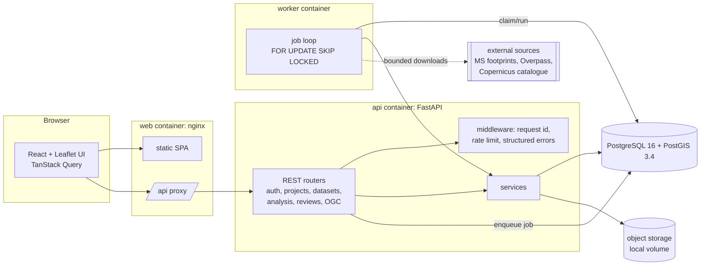
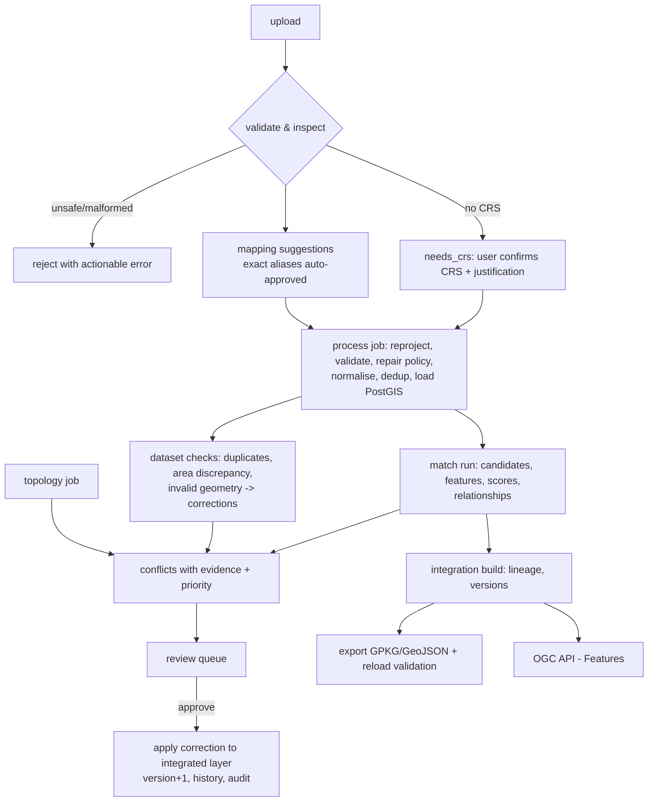

# Architecture

## System overview

* **API** (`backend/app/main.py`): FastAPI app with routers under `app/api/`. All requests pass through
  `RequestContextMiddleware` (correlation id `X-Request-ID`, per-IP rate limit, security headers,
  access log) and structured error handlers (`{"error": {code, message, details, request_id}}`).
* **Worker** (`app/worker.py`, `app/jobs.py`): background jobs are rows in `processing_jobs`. Workers
  claim them with `SELECT … FOR UPDATE SKIP LOCKED` (safe with several workers), heartbeat, enforce a
  timeout, retry transient DB errors, and re-queue jobs from dead workers. No Redis/Celery was added:
  PostgreSQL already provides durable, transactional queueing for this workload.
* **Services** (`app/services/`) hold all domain logic and are used by both API and worker.
* **Storage** (`app/storage.py`): `Storage` protocol with a local filesystem implementation
  (streamed writes, size limits, path-traversal-safe keys). An S3-compatible implementation can be
  added behind the same interface.

## Processing pipeline

## Geometry handling

Every source feature stores three geometries:

| column | CRS | purpose |
|---|---|---|
| `geom_source` | source CRS (unaltered) | provenance; never modified |
| `geom` | EPSG:4326 | display, interchange, export |
| `geom_work` | project working CRS (projected, metres) | all distance/area/overlap computations |

Working CRSs are validated as projected and metre-based; by default the WGS84 UTM zone of the study
area centroid (e.g. EPSG:32643 for Pune/Mumbai/Delhi, 32644 for Chennai/Hyderabad, 32645 for Kolkata).
Reprojection uses PROJ through pyproj (`always_xy`). GiST indexes exist on all geometry columns.

## Database schema (PostGIS)

Migration: `backend/alembic/versions/0001_initial_schema.py`.

| table | purpose |
|---|---|
| `users`, `project_members` | accounts (argon2 hashes), global role, per-project role cap |
| `projects`, `study_areas` | working CRS, tolerance, settings; study-area polygons |
| `datasets`, `dataset_versions` | provenance/licence/reliability; versioned files (unique on `(dataset_id, file_sha256)`), schema, field profile, CRS, status, processing log |
| `source_features` | original attributes, normalised attributes, three geometries, validity, repair status, row hash, duplicate pointer, prediction review status; unique `(dataset_version_id, source_fid)` |
| `raster_assets` | raster metadata (CRS, resolution, COG flag, footprint) |
| `field_mappings`, `field_aliases` | suggestions and decisions; project aliases |
| `match_runs`, `match_candidates` | parameters, stats; per-pair feature vector, score, score kind, class, relationship, explanation, review status, training label |
| `conflicts` | category, severity, priority, confidence, evidence, proposed action, legal flag, status, stable fingerprint (unique per project) |
| `corrections` | original and proposed geometry/attributes, safety class, method, metrics, base version, status |
| `review_decisions` | **append-only** decision log |
| `integrated_features`, `integrated_feature_history` | integrated layer with lineage and version; **append-only** history |
| `change_records` | vector/image change results |
| `processing_jobs` | queue with progress, result, error, attempts, heartbeat, idempotency key |
| `model_versions` | algorithm, feature schema, metrics, training info, artefact checksum, active flag |
| `acquisition_manifests` | every acquisition attempt: status, reachability, files with checksums |
| `audit_events` | **append-only**, hash-chained audit log |

Append-only tables are protected by a `BEFORE UPDATE OR DELETE` trigger. As a consequence projects are
archived rather than deleted, and datasets with reviewed/integrated dependants can only be archived.

## Roles

`viewer < analyst < reviewer < admin`. A user's effective role in a project is the lower of the
global role and the project membership role (owners keep their global role; admins have full access).

| action | minimum role |
|---|---|
| read project data | viewer (personal attributes redacted below reviewer) |
| create projects/datasets, upload, process, match, export | analyst |
| review decisions, labels, train models, integration build, archive datasets | reviewer |
| approve legally sensitive items (with acknowledgement), activate models, manage users | admin |
